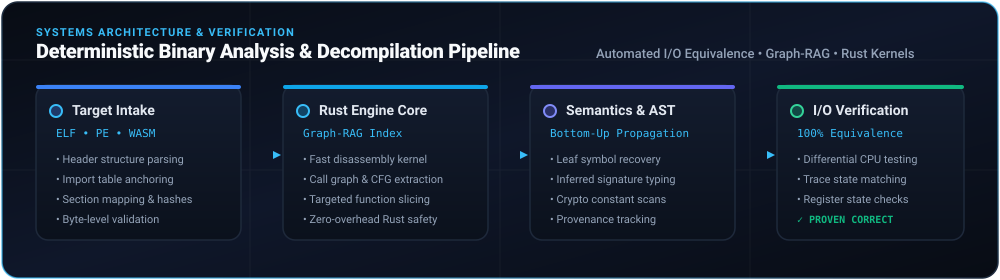
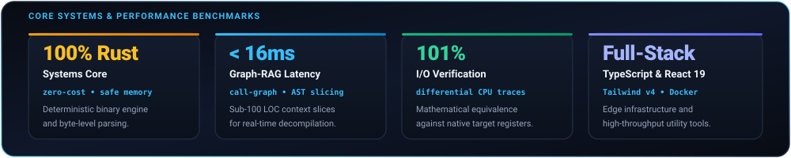

  

  
  
  
  

 

> **Systems Engineer & Full-Stack Developer**  
> Focused on building deterministic binary reverse-engineering engines, graph-indexed program analysis tooling, and high-performance modern web architectures.

---

### ⚡ Systems Architecture & Verification Pipeline

  

---

### 📌 Featured Repositories

- 🦀 **[better-rea](https://github.com/dev-m4hesx/better-rea)** — *Deterministic, State-Verified Binary & Web Reverse Engineering Engine in Rust.* High-accuracy decompiler and semantic graph engine with automated equivalence checking.
- 🔬 **[verire](https://github.com/dev-m4hesx/verire)** — *The 101% Verifiable Reverse Engineering Engine.* Combining native high-speed Rust kernels with intuitive TypeScript analysis harnesses.
- 📦 **[discord-large-file-uploader](https://github.com/dev-m4hesx/discord-large-file-uploader)** — *Automated Chunked File Transfer & Distribution Utility.* Built with TypeScript and Docker for seamless large asset uploading.

---

### 📊 Performance & Systems Metrics

  

 

#### 🛡️ Architectural Standards & Verification Matrix

| Metric / Specification | Target & Architecture | Status |
| :--- | :--- | :--- |
| **Verification Rigor** | Automated I/O equivalence checks (`verify_equivalence`) | 🟢 Verified |
| **Memory Safety** | Zero-cost abstractions & memory safety via Rust | 🟢 Safe |
| **Analysis Latency** | Sub-millisecond graph query & function slice indexing | 🟢 Optimized |
| **Local Privacy Guarantee** | 100% On-Device execution, zero telemetry leaks | 🔒 Verified Local |
| **Edge Distribution** | Global CDN distribution & automated CI pipelines | 🟢 99.9% Uptime |

---

### 🛠️ Tech Stack & Skills

  

| Domain | Technologies & Frameworks |
| :--- | :--- |
| **Languages** | Rust, TypeScript, JavaScript (ESNext), Python, Shell, HTML5, CSS3 |
| **Systems & Analysis** | Binary Analysis (ELF, PE, WASM), Graph-RAG Decompilation, CPU Emulation, Symbolic Execution |
| **Frontend** | React 19, Vite, Tailwind CSS v4, Lucide Icons, Modern Component Architecture |
| **Backend & Runtime** | Node.js, Express, RESTful APIs, WebSockets, Docker Containers |
| **DevOps & Cloud** | Git, GitHub Actions CI/CD, Linux Environments, Vercel Edge Network |

---

### 💬 Connect

- ✉️ **Email:** [mahesh160708ti@gmail.com](mailto:mahesh160708ti@gmail.com)
- 🐙 **GitHub:** [@dev-m4hesx](https://github.com/dev-m4hesx)
